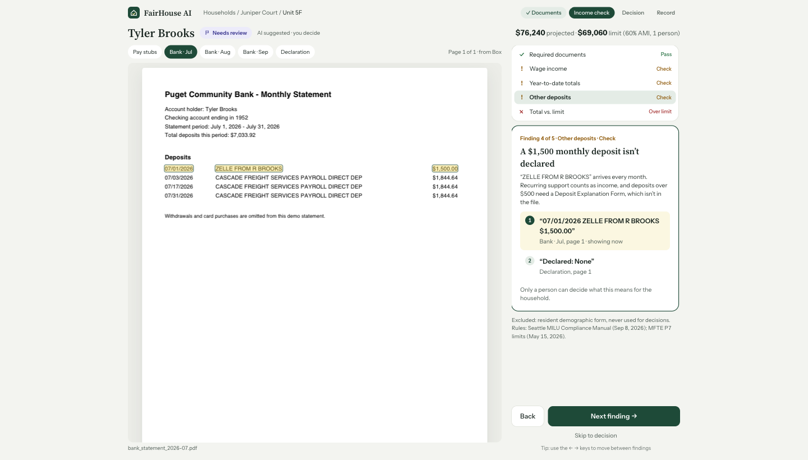
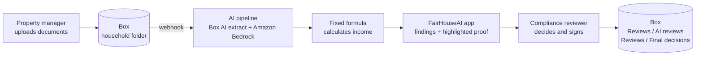

# FairHouseAI

**AI income reviews for affordable housing, with the proof for every finding.**

FairHouseAI checks a tenant's income file (pay stubs, bank statements, income declaration) against the program's rules, highlights the exact words behind every finding, and leaves the decision to a person. Everything stays in Box.

Built at the Agentic Enterprise AI Hackathon with Box + AWS (Seattle, October 2026).



## What it does

- **Reads every document** in a household's Box folder and pulls out each income amount.
- **Cross-checks documents against each other**: pay stubs vs. bank deposits, undeclared recurring deposits, missing statements.
- **Shows the proof**: every finding links to the exact quote and page, highlighted in the PDF.
- **A person decides**: the reviewer approves, requests documents, or marks not eligible, with a reason. The signed record and the AI review are saved to Box.

## The problem

To rent an income-restricted home, a household proves its income with three months of pay stubs and bank statements. A property manager adds it up by hand in a spreadsheet, and the city audits a sample of files later.

- In Seattle, a **7-person team** oversees **7,477 income-restricted homes** in 304 buildings ([2025 MFTE Annual Report](https://www.seattle.gov/documents/Departments/Housing/Reports/MFTEReports/2025_OH_MFTE_AnnualReport.pdf), pp. ii, 50).
- About **half the buildings** were still missing complete 2025 income reports after the deadline, and the city has **never revoked a tax exemption**, citing limited staff (same report, p. 71).
- After the first review, the rules only require checking **at least 1 in 5 files, about every 3 years** ([Compliance Manual](https://www.seattle.gov/documents/Departments/Housing/PropertyManagers/MFTECompliance/Compliance_Manual_MILU_Agreements.pdf), pp. 14-15).
- Nationally, HUD's Inspector General found **$1.29B a year** in improper rental payments from income calculation errors and missing documents ([HUD OIG 2026-BO-0002](https://www.oversight.gov/reports/audit/huds-multifamily-project-based-rental-assistance-program-had-significant-improper), Sep 2026).

Every wrong approval is a home a family on the waitlist doesn't get. Every wrong rejection turns an eligible family away.

## How it works



1. **Upload**: tenant documents land in the household's Box folder. Access follows Box folder permissions.
2. **Read**: a Box webhook triggers the pipeline. Box AI extracts each document; Amazon Bedrock flags anything missing, contradictory, or suspicious.
3. **Calculate**: plain code applies the program's income formula (`data/rules/rules.md`, section 4). No AI in the math.
4. **Review**: the reviewer steps through each finding with the source text highlighted in the PDF.
5. **Decide**: the reviewer signs a decision with a required reason. The AI review goes to `Reviews / AI reviews`, the signed record PDF (with a SHA-256 fingerprint) to `Reviews / Final decisions`. Tenant documents are never modified.

## Fair by design

- **Proof for every finding**: an exact quote and page, or it isn't shown.
- **Same rules for everyone**: the rules version is stamped on every result and record.
- **Demographic data is never used**: the Resident Demographic Form stays in the file because the program requires it, but it is excluded from reading and decisions.
- **A person always decides**: the AI suggests a status; only a reviewer can sign.

## Tech stack

- **Frontend**: React 19, TypeScript, Vite 6, Tailwind CSS 4, react-pdf (PDF.js) for viewing and highlighting
- **Backend**: Python, FastAPI, Box Python SDK (`box_sdk_gen`)
- **Box**: OAuth sign-in, folder permissions for roles, file storage, webhooks, Box AI structured extraction
- **AWS**: Amazon Bedrock (Nova) for review routing, AWS Lambda + API Gateway for the webhook pipeline
- **Rules**: Seattle MFTE Program 7, 2026 income limits, as a versioned rule set (`data/rules/`)

## Status: what's live and what's next

- **Live on real Box**: Box sign-in with roles from folder access, households and files from Box, PDFs streamed from Box, signed decisions and AI reviews saved to Box, audit log.
- **Precomputed for the demo**: the findings shown in the review screen for the three test households come from the answer key (`backend/app/demo_results.json`), with every quote verified against the PDFs.
- **Running separately**: the Box webhook pipeline (branch `pepperson/webhook`) writes its own review report to Box.
- **Next**: connect the pipeline's output to the review screen, Box Sign for signatures, file locks and metadata labels on Box plans that support them, more rule sets beyond Seattle.

## Demo households (all synthetic)

- **Maria Lopez, Unit 2A: Qualifies.** $24/hr = $49,920, under the $69,060 limit (1 person, 60% AMI).
- **Daniel Kim, Unit 3C: Missing info.** Only 2 of the 3 required bank statements.
- **Tyler Brooks, Unit 5F: Needs review.** Stubs say $20/hr but payroll deposits match $28/hr, an undeclared $1,500 monthly deposit, and income over the limit.

All tenant data is synthetic and watermarked. Regenerate with `pip install -r scripts/requirements.txt && python scripts/generate_households.py`.

## Run it locally

**Frontend only, on mock data (no keys needed):**
```
cd frontend
npm install
npm run dev                     # http://localhost:5173
```

**Full app on real Box:**
```
cp .env.example .env            # real values are shared privately; never commit .env
cd backend
uv venv && uv pip install -r requirements.txt
.venv/bin/uvicorn app.main:app --port 8000

cd ../frontend
VITE_USE_MOCK=false npm run dev
```
Your role comes from Box: you're a **compliance reviewer** if your Box account can open the "Seattle Office of Housing" folder, and a **property manager** if it can only open "Juniper Court Apartments". `scripts/box_setup.py` creates the folders and files (safe to re-run).

Fallback if Box sign-in breaks: set `AUTH_MODE=demo`, have a reviewer open `/auth/box/login?service=1` once, then `/auth/demo/login?role=analyst` or `?role=property_manager` signs in over that one shared connection.

## Repo layout

```
frontend/          React app (sign-in, dashboard, review, decision, record, audit log, rules, upload)
backend/app/       FastAPI: Box sign-in (auth.py), households, checks, files, decisions (households.py)
data/rules/        Seattle rules in plain English with page refs, 2026 income limits, sources
data/households/   3 synthetic tenant files + expected_results.json (the answer key)
scripts/           Box setup and synthetic household generator
docs/              pitch write-up and screenshots
```

## Team

[Team names]
