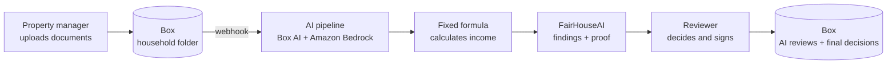

# FairHouseAI

**AI income reviews for affordable housing, with the proof for every finding.**

FairHouseAI checks a tenant's income documents against the program's rules, highlights the exact words behind every finding, and leaves the decision to a person. Everything stays in Box.


## What it does

- **Reads** every document in a household's Box folder.
- **Cross-checks** documents: pay stubs vs. bank deposits, undeclared deposits, missing statements.
- **Shows the proof**: each finding links to the exact quote and page, highlighted in the PDF.
- **A person decides**, with a reason. The signed record and the AI review are saved to Box.

## The problem

Tenants prove their income with pay stubs and bank statements. Property managers add it up by hand, and the city audits a sample later.

- In Seattle, **7 people** oversee **7,477 income-restricted homes** ([2025 MFTE Annual Report](https://www.seattle.gov/documents/Departments/Housing/Reports/MFTEReports/2025_OH_MFTE_AnnualReport.pdf), pp. ii, 50).
- **Half the buildings** were behind on 2025 income reports, and no tax exemption has ever been revoked, citing limited staff (same report, p. 71).
- The rules only require checking **1 in 5 files, about every 3 years** ([Compliance Manual](https://www.seattle.gov/documents/Departments/Housing/PropertyManagers/MFTECompliance/Compliance_Manual_MILU_Agreements.pdf), pp. 14-15).
- Nationally, income errors cost **$1.29B a year** in HUD rental aid ([HUD OIG, Sep 2026](https://www.oversight.gov/reports/audit/huds-multifamily-project-based-rental-assistance-program-had-significant-improper)).

Every wrong approval is a home a waitlisted family doesn't get.

## How it works



1. **Upload**: documents land in the household's Box folder. Access follows Box permissions.
2. **Read**: a Box webhook triggers Box AI extraction; Amazon Bedrock flags anything missing or contradictory.
3. **Calculate**: plain code applies the program's formula. No AI in the math.
4. **Review**: each finding is shown with its source text highlighted.
5. **Decide**: the reviewer signs with a reason. The AI review and the signed record (with a SHA-256 fingerprint) are saved to Box. Tenant documents are never modified.

## Fair by design

- **Proof for every finding**, or it isn't shown.
- **Same rules for everyone**: the rules version is stamped on every result.
- **Demographic data is never used**: the form stays in the file but is excluded from reading and decisions.
- **A person always decides**: the AI only suggests.

## Tech stack

- **Frontend**: React, TypeScript, Vite, Tailwind CSS, react-pdf
- **Backend**: Python, FastAPI, Box Python SDK
- **Box**: OAuth sign-in, folder permissions, storage, webhooks, Box AI extraction
- **AWS**: Amazon Bedrock, AWS Lambda, API Gateway
- **Rules**: Seattle MFTE Program 7, 2026 income limits (`data/rules/`)

## What's live and what's next

- **Live on Box**: sign-in with roles from folder access, households and PDFs from Box, decisions and AI reviews saved to Box, audit log.
- **Precomputed**: review findings for the three synthetic test households (`backend/app/demo_results.json`).
- **Separate**: the webhook pipeline (branch `pepperson/webhook`) writes its report to Box.
- **Next**: pipeline output in the review screen, Box Sign, more rule sets.

## Run it locally

Mock data, no keys needed:
```
cd frontend && npm install && npm run dev        # http://localhost:5173
```

Real Box (needs `.env`, shared privately, never committed):
```
cd backend && uv venv && uv pip install -r requirements.txt
.venv/bin/uvicorn app.main:app --port 8000
cd ../frontend && VITE_USE_MOCK=false npm run dev
```

Your Box access sets your role: the "Seattle Office of Housing" folder makes you a reviewer; only "Juniper Court Apartments" makes you a property manager. `scripts/box_setup.py` creates the folders.

## Repo layout

```
frontend/        React app
backend/app/     FastAPI: Box sign-in, households, checks, files, decisions
data/rules/      program rules, income limits, sources
data/households/ synthetic tenant files and the answer key
scripts/         Box setup and data generator
```
